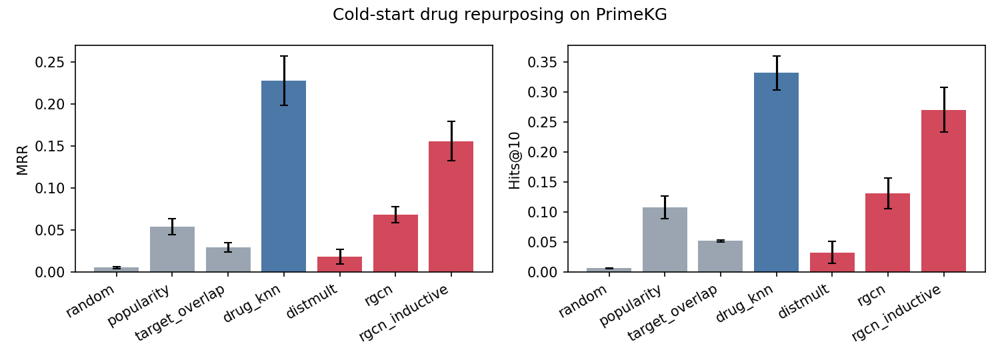

# drug-repurposing-kg

Can a GNN on the PrimeKG biomedical knowledge graph predict which diseases a drug treats,
for drugs it has never seen an indication for?

**Short answer:** partly. A relational GNN with an inductive drug encoder gets well above
popularity and well above a memorising baseline, but a simple "diseases of the most similar
training drugs" kNN still beats it on MRR and Hits@10. Retrospective ranking only, not a clinical claim.



## Setup

- **Graph:** [PrimeKG](https://github.com/mims-harvard/PrimeKG) restricted to drugs, diseases,
  genes/proteins, effects/phenotypes, pathways and exposures: 71,353 nodes, 748,275 undirected
  edges, 14 relations. Drug-drug interactions and the anatomy and gene-ontology subgraphs are
  dropped to keep CPU training practical.
- **Target:** the 9,388 drug-disease `indication` pairs (1,801 drugs, 1,363 diseases).
- **No label leakage:** every drug-disease edge (indication, contraindication, off-label use)
  is removed from the message-passing graph for *all* drugs. A drug is represented only through
  its targets, side effects and other non-drug-disease relations. Keeping contraindications for
  some drugs would leak labels or create a train/test mismatch.
- **Cold-start split:** whole drugs are held out (80/10/10 by drug, 3 random seeds), so a test
  drug has no known indications at all.
- **Evaluation:** each held-out indication is ranked against all 1,363 candidate diseases. Ranks
  are *filtered* (a drug's other true diseases do not compete) and ties get their average rank,
  which matters for coarse scores like popularity. Random scoring has a mean rank of about 680.

## Models

| model | what it does |
|---|---|
| `random`, `popularity` | sanity floor; popularity ranks diseases by how many training drugs they treat |
| `drug_knn` | scores diseases by those of the 25 most similar training drugs (cosine over targets and side effects) |
| `target_overlap` | overlap between a drug's targets and a disease's associated genes |
| `distmult` | shallow KG embeddings trained on all graph triples |
| `rgcn` | 2-layer R-GCN with a free embedding per node, DistMult decoder |
| `rgcn_inductive` | same R-GCN, but all drugs share one input embedding, so a drug's representation comes only from its neighbourhood |

## Results

Mean ± std over 3 cold-start splits:

| model | MRR | Hits@10 | Hits@50 | mean rank |
|---|---|---|---|---|
| random | 0.005 ± 0.001 | 0.006 ± 0.000 | 0.033 ± 0.004 | 690 ± 10 |
| popularity | 0.054 ± 0.009 | 0.108 ± 0.019 | 0.277 ± 0.019 | 305 ± 20 |
| target_overlap | 0.029 ± 0.006 | 0.052 ± 0.002 | 0.148 ± 0.007 | 573 ± 4 |
| **drug_knn** | **0.227 ± 0.030** | **0.331 ± 0.028** | **0.520 ± 0.041** | 286 ± 17 |
| distmult | 0.019 ± 0.009 | 0.032 ± 0.018 | 0.099 ± 0.048 | 578 ± 107 |
| rgcn | 0.068 ± 0.009 | 0.131 ± 0.025 | 0.324 ± 0.031 | 299 ± 21 |
| rgcn_inductive | 0.156 ± 0.024 | 0.270 ± 0.038 | 0.489 ± 0.060 | **205 ± 21** |

The inductive R-GCN loses to `drug_knn` on MRR in all 3 splits (by 0.02 to 0.12), but has the best
mean rank: where it misses, it misses less badly. See [`results/summary.md`](results/summary.md).

### What I take from this

1. **Free per-node embeddings are the wrong tool for cold-start.** The plain R-GCN's training loss
   fell from 1.15 to 0.25 while validation MRR stalled near 0.08: it memorised the training drugs.
   `distmult` is worse still, and its validation MRR *fell* after the second epoch.
2. **Making drugs inductive fixes most of that.** With one shared drug input embedding, validation
   MRR roughly doubled (0.083 to 0.167 on the development seed) and test MRR is 0.156 versus 0.068.
   I chose this change from the validation curves, before looking at test numbers.
3. **A simple similarity baseline is hard to beat.** `drug_knn` has the best MRR and Hits@10. Part of
   that is probably near-duplicate drugs (analogues sharing targets), which a random drug split cannot
   rule out; see limitations.
4. **Target-gene overlap is a weak signal on its own** (below popularity on MRR).

### Things that went wrong along the way

- **Premature early stopping, seed 1.** The first inductive run on seed 1 stopped at step 70 (patience
  of 5 evaluations during a slow start) and scored MRR 0.046. Seeds 0 and 2 climbed through all 400 steps.
  I re-ran seed 1 with patience 15, which then trained all 400 steps and scored 0.128. Seeds 0 and 2
  never triggered early stopping, so their results are unchanged. The original row is kept in
  `results/rgcn_inductive_seed1_early_stopped.csv`. Note the re-run happened *after* seeing the bad number.
  The reason is documented above, but it is a post hoc fix, and the other models kept patience 5.
- **Unequal budgets.** The plain `rgcn` and `distmult` ran with the original settings (150 steps, patience 5)
  while `rgcn_inductive` ran 400 steps. To check this was not driving the gap, I re-ran the plain R-GCN on
  seed 0 with the same 400 steps and patience 15 (`results/ablation_rgcn_equal_budget_seed0.csv`). Test MRR
  went from 0.077 to 0.085, against 0.168 for the inductive version on the same split, so the extra budget
  barely helps and the gap is not an artifact of training length. This check is one seed only, and `distmult`
  was not re-run.

## Limitations

- **No temporal split.** PrimeKG is an undated snapshot, so I could not test on indications approved after
  the graph was built. The cold-start drug split is the closest available check.
- **Similar drugs are not separated.** Holding out random drugs leaves close analogues of test drugs in the
  training set, which flatters similarity-based methods like kNN. A split that holds out clusters of similar
  drugs would be a harder and fairer test, and I did not run it.
- **Only 3 splits**, with noticeable variance (MRR std about 0.02-0.03), so small gaps are not meaningful.
- **No hyperparameter search.** Dimension 64, learning rate 5e-3 and 2 layers were fixed. Only steps and
  patience were adjusted, based on validation curves.
- **No heterogeneous graph transformer.** I planned to compare an HGT as well and did not get to it.
- **Candidate set** is the 1,363 diseases with at least one indication anywhere in the data, which is easier
  than ranking all 17,080 diseases.
- **Not clinical evidence.** These are rankings against known labels. Nothing here supports a medical
  claim about any drug, and no per-drug predictions are included.

## Reproduce

```bash
conda env create -f environment.yml && conda activate bioml
# download PrimeKG nodes.tab and edges.csv (Harvard Dataverse, doi:10.7910/DVN/IXA7BM) into data/raw/
python scripts/run_experiments.py --seeds 3                                    # baselines, distmult, rgcn
python scripts/run_experiments.py --seeds 3 --models rgcn_inductive --steps 400 --patience 15
python scripts/make_report.py
pytest
```
